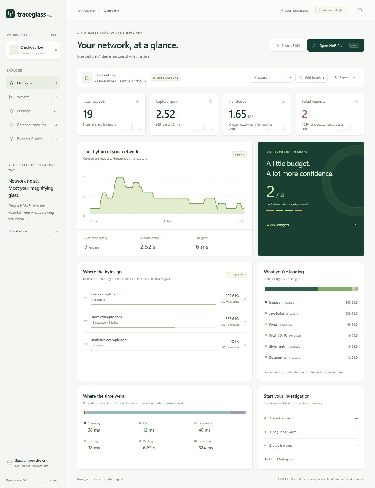
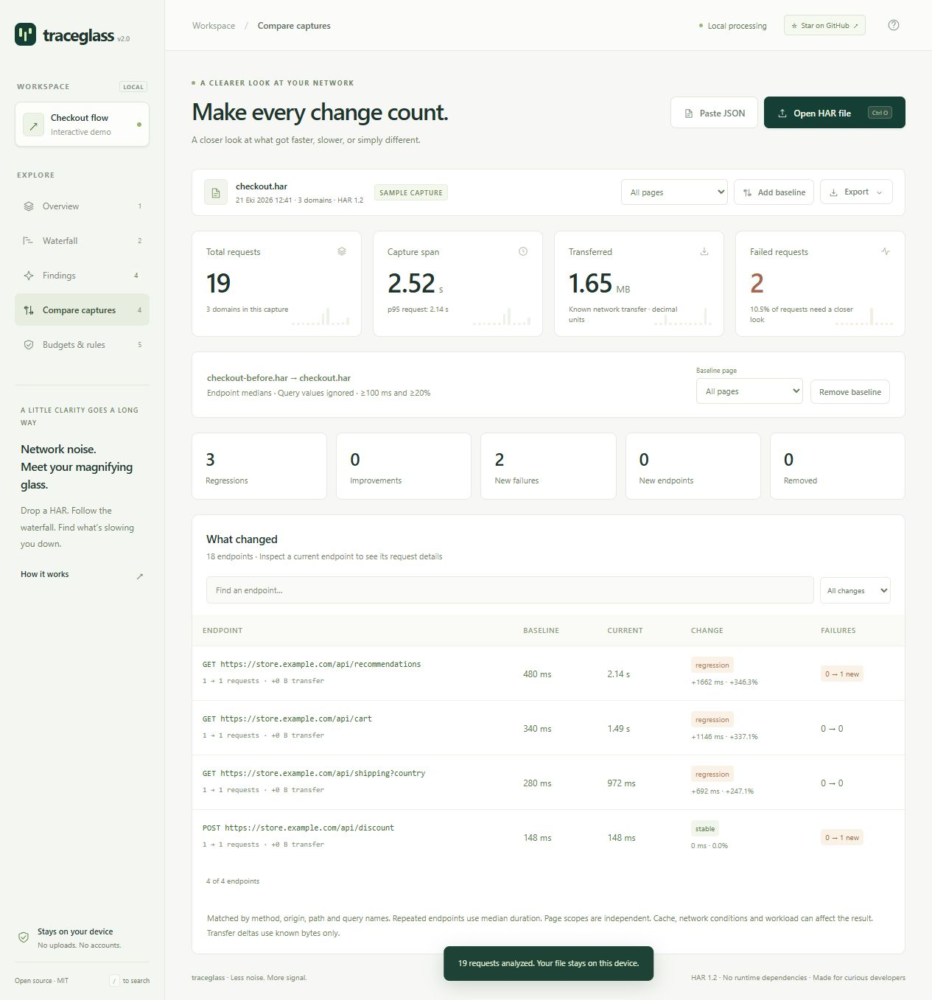

# Traceglass

**HAR kayıtlarını anlaşılır bir ağ analizine dönüştüren, cihazında çalışan geliştirici aracı.**

[Canlı demo](https://fkalsasx.github.io/traceglass/) · [English](README.md) · [Gizlilik politikası](docs/PRIVACY.md) · [Hesaplama yöntemi](docs/METHODOLOGY.md)



Bir sayfanın neden yavaş olduğunu anlamak için yüzlerce isteğin arasında kaybolma. Kaydı aç, zaman çizelgesini incele, önceki sürümle karşılaştır ve paylaşılabilir raporu indir.

## Çalıştır

Node.js 22 veya üzeri gerekir.

```sh
git clone https://github.com/fkalsasx/traceglass.git
cd traceglass
npm start
```

**http://127.0.0.1:4273** adresini aç. Kurulum, API anahtarı ve hesap gerekmez. Örnek kayıt otomatik yüklenir.

## Neler yapar?

- Eşzamanlı istek grafiği, alan adı/tür dağılımı ve bekleme süreleriyle genel bakış sunar.
- İstekleri zaman çizelgesinde gösterir; URL, tür ve durum koduyla filtreler.
- Uzun ilk bayt beklemelerini, büyük dosya aktarımlarını ve başarısız istekleri işaretler.
- Önce/sonra kayıtlarında aynı uç noktaların medyan sürelerini karşılaştırır.
- HTML, Markdown ve CSV raporları; hassas alanları azaltılmış HAR dosyası oluşturur.
- Komut satırında performans bütçesi denetimi ve JSON çıktı sunar.
- Çok sayfalı HAR kayıtlarında sayfa seçimine göre tüm metrikleri yeniden hesaplar.
- Ayarlanabilir bütçe ve bulgu eşiklerini JSON profili olarak içe/dışa aktarır.
- `status:5xx time:>1s -domain:analytics` gibi birleşik aramaları destekler.
- Kayıtları, karşılaştırma tabanını ve analiz profilini JSON yapıştırarak açar.



## Komut satırı

```sh
node bin/traceglass.mjs analyze examples/checkout.har
node bin/traceglass.mjs analyze examples/checkout.har --baseline examples/checkout-before.har --format markdown --output rapor.md
node bin/traceglass.mjs sanitize examples/checkout.har --output temiz.har
node bin/traceglass.mjs analyze examples/checkout.har --fail-on-errors --max-p95 800
node bin/traceglass.mjs analyze examples/checkout.har --format html --output rapor.html
node bin/traceglass.mjs analyze examples/checkout.har --config examples/profile.json
node bin/traceglass.mjs analyze examples/checkout.har --query "status:5xx time:>1s"
```

Çıkış kodları: **0** başarılı, **1** geçersiz girdi/dosya hatası, **2** belirlenen bütçe veya hata eşiği aşıldı. Mevcut çıktı dosyalarının üzerine yazılmaz.

`--config` verildiğinde etkin bütçeler zorunlu denetlenir; eksik aktarım boyutu nedeniyle doğrulanamayan bütçe de 2 çıkış kodu üretir. Bu seçenek verilmezse varsayılan bütçeler bilgi amaçlıdır. Tek bir bütçeyi kapatmak için profil değerini `null` yapabilirsin. Eksik alanlar varsayılan değerleri alır. [Örnek profil](examples/profile.json).

Tarayıcıda **Budgets & rules** ekranından profili değiştirip dışa aktarabilirsin. İçe aktarmak için **Paste JSON → Analysis profile** seç. Profiller bellekte tutulur; sayfayı yenilemek sıfırlar. Sayfa seçimi raporları da sınırlar; arama kutusu yalnızca istek tablosunu filtreler. HTML raporu bağımsız açılabilir ve tarayıcıdan PDF olarak yazdırılabilir.

## Gizlilik sınırları

Kayıtlar tarayıcı belleğinde işlenir; sunucuya gönderilmez veya kalıcı depolamaya kaydedilmez. Sayfayı yenilemek çalışma alanını temizler. Ham gövdeler, çerezler ve kimlik doğrulama başlıkları arayüzde gösterilmez.

Temizlenmiş HAR çıktısında çerezler, gövdeler, yorumlar, IP alanları ve bilinmeyen ek alanlar çıkarılır. Sorgu değerleri ve izin listesindeki başlıklar dışındaki başlık değerleri gizlenir. **URL yolları, alan adları, sorgu adları ve bazı metaveriler korunur; bunlar hassas bilgi içerebilir. Paylaşmadan önce çıktıyı incele.** Bu araç bütün sırların bulunacağını garanti etmez.

50 MiB ve 50.000 istek sınırı vardır. Karşılaştırma sonuçları aynı ağ/önbellek/yük koşullarında alınan kayıtlarda anlamlıdır. Otomatik bulgular belirli kurallara dayanır; kapsamlı güvenlik veya performans denetiminin yerini tutmaz.

## Geliştirme

```sh
npm test
npm run check
npm run build
```

`dist/` dizini statik sunucuda yayımlanabilir. GitHub Pages için Settings → Pages → GitHub Actions seç. `main` dalına gönderilen arayüz/analiz motoru değişiklikleri otomatik yayımlanır; **Deploy demo** iş akışı elle de çalıştırılabilir.

MIT lisansı. Yararlı bulursan yıldız vererek projenin keşfedilmesine yardımcı olabilirsin.
